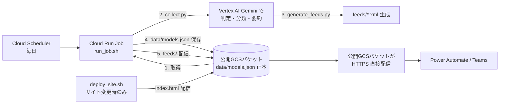

# LLM Model Watch Feed


LLM Model Watch Feed は、LLM モデルに関する重要な更新だけを集めて RSS とサイトで配信する小さなウォッチサービスです。
収集・要約・フィード生成・配信は **GCP 上で毎日自動実行** され、公開は **公開GCSバケットが直接配信**（HTTPS）します。

新モデルの発表、性能改善、価格変更、API 提供開始、オープンウェイトモデル公開など、AI アプリ開発者が追うべき情報を RSS ソースから収集し、**Vertex AI（Gemini）** で分類・要約します。

## できること

| 機能 | 内容 |
| --- | --- |
| RSS 収集 | OpenAI、Anthropic、Google DeepMind、Hugging Face などの RSS を取得 |
| LLM 判定 | モデル関連ニュースかどうかを Vertex AI（Gemini）で判定（未設定時はダミー要約で動作） |
| 重要度分類 | A / B / C の重要度、モデル種別、タグを付与 |
| RSS 配信 | 用途別の RSS フィードを生成し公開GCSバケットで配信 |
| サイト公開 | `index.html` でフィード URL と最新記事を公開 |
| Teams 通知 | Power Automate の RSS トリガーから Teams へ通知可能 |

## 仕組み（GCP 構成）

配信は公開GCSバケットが直接担い、サイトの「デプロイ」は不要です。
パイプラインは **ニュース更新（毎日・自動）** と **サイトデプロイ（HTML変更時のみ・手動/CI）** に分離しています。



- 状態 `data/models.json` の正本は **公開GCSバケット**（DB は使いません）。実行ごとに「取得 → 更新 → 保存」し、それがそのまま配信されます。
- 収集・生成・配信は **Cloud Run Job** が 1 回で実行し、**Cloud Scheduler** が毎日トリガーします。
- 配信は **公開GCSバケットが直接担当**（サイトのデプロイ不要）。サイト（`index.html`）の更新だけ `scripts/deploy_site.sh` で分離。
- 独自ドメイン・きれいな URL は後追いで **HTTPS ロードバランサ + Cloud CDN + マネージドSSL** を前段に置いて付与（パイプラインは無変更。[DEPLOY.md](DEPLOY.md) §6）。
- LLM 認証は **ADC（実行サービスアカウント）** で行い、API キーは不要。公開ファイルには機密を含めません。

## 対象にする情報

このプロジェクトは、AI アプリ開発や PoC の判断に直接影響するモデル情報を優先します。

- 新しい LLM / マルチモーダル / reasoning / coding モデルの発表
- 既存モデルの性能改善、コンテキスト長拡張、API 仕様変更
- 価格、レート制限、提供リージョン、提供開始・終了の変更
- オープンウェイトモデルの公開
- 推論モデル、埋め込み、音声、動画モデルなどの重要な更新

> ※ スコープは AI ニュース全般への拡大方針です。現行コードはモデル関連判定が残っており、段階的に一般化します。

## ローカル実行

スクリプトはローカルでもそのまま動きます（入出力先は環境変数で切替可能。既定は `docs/` 配下）。
Vertex AI を使うには `GCP_PROJECT` と ADC が必要です（未設定ならダミー要約で動作）。

```bash
git clone https://github.com/rararapi/llm-watch-feed
cd llm-watch-feed
python -m venv .venv && . .venv/bin/activate
pip install -r requirements.txt
cp .env.example .env   # GCP_PROJECT を設定（未設定ならダミー要約で動作）

# Vertex AI を実際に使う場合のみ（ADC 認証）
gcloud auth application-default login
```

```bash
# 収集・分類（GCP_PROJECT + ADC があれば Vertex AI。無ければダミー要約）
python scripts/collect.py
# RSS 生成
python scripts/generate_feeds.py
# サイト確認（file:// 不可）
cd docs && python -m http.server 8000   # http://localhost:8000
```

入出力先を変える場合（クラウド実行と同じ挙動の確認）:

```bash
MODELS_JSON_PATH=/tmp/out/models.json FEEDS_DIR=/tmp/out/feeds \
  python scripts/collect.py && \
MODELS_JSON_PATH=/tmp/out/models.json FEEDS_DIR=/tmp/out/feeds \
  SITE_URL=https://storage.googleapis.com/my-bucket python scripts/generate_feeds.py
```

## GCP へのデプロイ

構築手順（Cloud Run Job / Scheduler / 公開GCSバケット / Vertex AI）は **[DEPLOY.md](DEPLOY.md)** を参照してください。

- ニュース更新ジョブのエントリポイントは `scripts/run_job.sh`（取得 → collect → generate → data/models.json 保存 → feeds 配信）。
- サイト配信は `scripts/deploy_site.sh`（`index.html` 等を GCS へ。サイト変更時のみ実行）。

環境変数（ジョブ）:

| 名前 | 説明 |
| --- | --- |
| `GCS_BUCKET` | 公開配信／状態バケット名（必須） |
| `SITE_URL` | 公開サイト URL（フィードの自己リンク用。当面はバケットURL、独自ドメイン設定後はそのURL） |
| `GCP_PROJECT` | Vertex AI のプロジェクト ID（ADC 認証。未設定ならダミーモード） |
| `VERTEX_LOCATION` | Vertex AI のリージョン（既定 `us-central1`） |
| `VERTEX_MODEL` | Gemini モデル名（既定 `gemini-2.5-flash`） |
| `GCS_OBJECT` | 状態＝配信データのキー（既定 `data/models.json`） |
| `MODELS_JSON_PATH` / `FEEDS_DIR` | 入出力先（ジョブ内で `public/` 配下に設定） |
| `SITE_DIR` | サイト静的ファイルのディレクトリ（`deploy_site.sh` 用、既定 `docs`） |

## 公開 RSS フィード

| フィード | パス | 内容 |
| --- | --- | --- |
| All | `/feeds/all.xml` | 重要度 A または B のすべてのモデル情報 |
| Major Models | `/feeds/major-models.xml` | 重要度 A の主要モデル情報 |
| Pricing | `/feeds/pricing.xml` | 価格・コスト関連 |
| Open Models | `/feeds/open-models.xml` | オープンウェイトモデル関連 |
| Coding | `/feeds/coding.xml` | コーディング性能・コード生成モデル関連 |
| Multimodal | `/feeds/multimodal.xml` | マルチモーダル、音声、動画モデル関連 |

公開URLが `https://storage.googleapis.com/<bucket>` の場合、All フィードは次の URL です。

```text
https://storage.googleapis.com/<bucket>/feeds/all.xml
```

> 独自ドメイン設定後は `https://news.example.com/feeds/all.xml` のようなクリーンな URL になります（[DEPLOY.md](DEPLOY.md) §6）。

## Power Automate で Teams に通知する

1. Power Automate で新しい自動化クラウドフローを作成
2. トリガーに **RSS フィードに新しいフィード項目が発行されたとき** を選択
3. RSS フィード URL に `/feeds/all.xml` などの絶対 URL を入力
4. アクションに **Microsoft Teams - メッセージを投稿する** を追加
5. メッセージ本文にフィードのタイトル、リンク、概要を配置
6. フローを保存して有効化

## 注意

- `.env` と認証情報は絶対にコミットしないでください。クラウドでは ADC（サービスアカウント）を使い API キーは不要です。
- `models.json` と `feeds/*.xml` は生成物です。クラウドでは GCS に出力され、リポジトリにはコミットしません。
- ローカル確認では `file://` ではなく HTTP サーバーを使ってください。

## 主要ファイル

```text
.
├── scripts/
│   ├── collect.py          # RSS 収集、Vertex AI 判定、models.json 更新
│   ├── generate_feeds.py   # models.json から RSS XML を生成
│   ├── gcs_sync.py         # GCS との download/upload/publish
│   ├── run_job.sh          # Cloud Run Job エントリポイント（ニュース更新）
│   └── deploy_site.sh      # サイト配信（変更時のみ）
├── docs/
│   ├── index.html          # 公開画面（公開GCSバケットで配信）
│   └── power-automate.html # Power Automate 設定ガイド
├── Dockerfile              # Cloud Run Job 用イメージ
├── requirements.txt        # ベース依存
├── requirements-job.txt    # ジョブ追加依存（GCS クライアント）
├── DEPLOY.md               # GCP デプロイ手順
└── README.md
```
