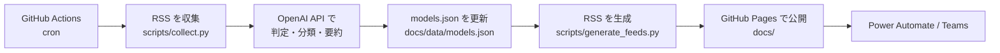

# LLM Model Watch Feed


LLM Model Watch Feed は、LLM モデルに関する重要な更新だけを集めて RSS と GitHub Pages で配信する小さなウォッチサービスです。

新モデルの発表、性能改善、価格変更、API 提供開始、オープンウェイトモデル公開など、AI アプリ開発者が追うべき情報を RSS ソースから収集し、OpenAI API で分類・要約します。

## できること

| 機能 | 内容 |
| --- | --- |
| RSS 収集 | OpenAI、Anthropic、Google DeepMind、Hugging Face などの RSS を取得 |
| LLM 判定 | モデル関連ニュースかどうかを OpenAI API で判定 |
| 重要度分類 | A / B / C の重要度、モデル種別、タグを付与 |
| RSS 配信 | 用途別の RSS フィードを `docs/feeds/` に生成 |
| GitHub Pages | `docs/index.html` でフィード URL と最新記事を公開 |
| Teams 通知 | Power Automate の RSS トリガーから Teams へ通知可能 |

## 対象にする情報

このプロジェクトは、AI アプリ開発や PoC の判断に直接影響するモデル情報を優先します。

- 新しい LLM / マルチモーダル / reasoning / coding モデルの発表
- 既存モデルの性能改善、コンテキスト長拡張、API 仕様変更
- 価格、レート制限、提供リージョン、提供開始・終了の変更
- オープンウェイトモデルの公開
- 推論モデル、埋め込み、音声、動画モデルなどの重要な更新

一般的な AI ニュース、企業導入事例、資金調達、法規制、セキュリティ記事は、モデル更新と直接関係しない限り対象外です。

## 仕組み



- サーバーと DB は使いません。
- GitHub Actions が火曜・金曜 09:00 JST に定期実行し、生成物を `docs/` にコミットします。
- API キーは GitHub Secrets またはローカル `.env` のみに置き、公開ファイルには含めません。

## ローカル実行

### 1. セットアップ

```bash
git clone https://github.com/YOUR_USERNAME/llm-watch-feed
cd llm-watch-feed
pip install -r requirements.txt
cp .env.example .env
```

`.env` に OpenAI API キーを設定します。

```env
OPENAI_API_KEY=sk-...
OPENAI_MODEL=gpt-4.1-mini
```

### 2. 記事を収集・分類

```bash
python scripts/collect.py
```

### 3. RSS フィードを生成

```bash
python scripts/generate_feeds.py
```

公開 URL を指定する場合は `SITE_URL` を渡します。

```bash
SITE_URL=https://your-username.github.io/llm-watch-feed python scripts/generate_feeds.py
```

### 4. ローカルで確認

`docs/index.html` は `file://` ではなくローカル HTTP サーバー経由で開いてください。

```bash
cd docs
python -m http.server 8000
```

ブラウザで `http://localhost:8000` を開きます。

## GitHub Pages の設定

1. GitHub リポジトリの **Settings** を開く
2. **Pages** を開く
3. Source を **Deploy from a branch** にする
4. Branch を `main`、Folder を `docs` にする
5. **Save** を押す

数分後に GitHub Pages の URL が発行されます。

## GitHub Secrets / Variables

| 名前 | 種別 | 説明 |
| --- | --- | --- |
| `OPENAI_API_KEY` | Secret | OpenAI API キー。必須 |
| `OPENAI_MODEL` | Variable | 分類に使うモデル名。未設定時は `gpt-4.1-mini` |

設定場所: **Settings** → **Secrets and variables** → **Actions**

## 公開 RSS フィード

| フィード | パス | 内容 |
| --- | --- | --- |
| All | `/feeds/all.xml` | 重要度 A または B のすべてのモデル情報 |
| Major Models | `/feeds/major-models.xml` | 重要度 A の主要モデル情報 |
| Pricing | `/feeds/pricing.xml` | 価格・コスト関連 |
| Open Models | `/feeds/open-models.xml` | オープンウェイトモデル関連 |
| Coding | `/feeds/coding.xml` | コーディング性能・コード生成モデル関連 |
| Multimodal | `/feeds/multimodal.xml` | マルチモーダル、音声、動画モデル関連 |

GitHub Pages の URL が `https://your-username.github.io/llm-watch-feed` の場合、All フィードは次の URL になります。

```text
https://your-username.github.io/llm-watch-feed/feeds/all.xml
```

## Power Automate で Teams に通知する

1. Power Automate で新しい自動化クラウドフローを作成
2. トリガーに **RSS フィードに新しいフィード項目が発行されたとき** を選択
3. RSS フィード URL に `/feeds/all.xml` などの絶対 URL を入力
4. アクションに **Microsoft Teams - メッセージを投稿する** を追加
5. メッセージ本文にフィードのタイトル、リンク、概要を配置
6. フローを保存して有効化

以後、新しい LLM モデル関連ニュースが検出されると Teams に投稿されます。

## 注意

- `.env` と API キーは絶対にコミットしないでください。
- `docs/` 以下は GitHub Pages で公開されます。
- `docs/data/models.json` と `docs/feeds/*.xml` は生成物です。
- ローカル確認では `file://` ではなく HTTP サーバーを使ってください。

## 主要ファイル

```text
.
├── scripts/
│   ├── collect.py          # RSS 収集、LLM 判定、models.json 更新
│   └── generate_feeds.py   # models.json から RSS XML を生成
├── docs/
│   ├── index.html          # GitHub Pages の公開画面
│   ├── data/models.json    # 収集済み記事データ
│   └── feeds/*.xml         # 公開 RSS フィード
├── assets/readme/
│   └── overview.png        # README 用画像
└── README.md
```
