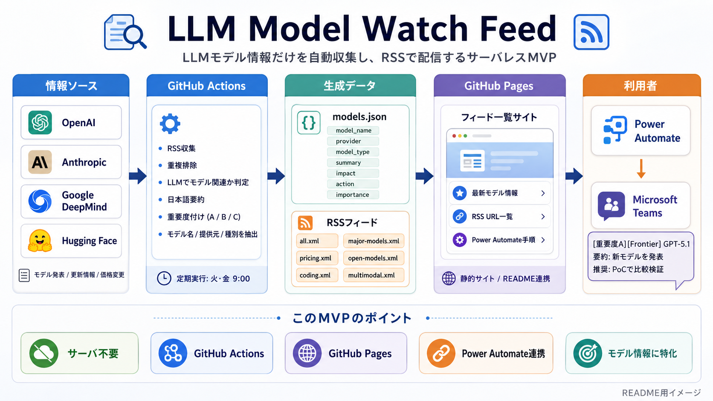
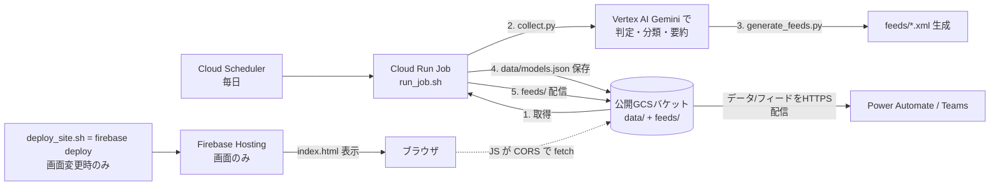

# LLM Model Watch Feed



LLM Model Watch Feed は、LLM モデルに関する重要な更新だけを集めて RSS とサイトで配信する小さなウォッチサービスです。
収集・要約・フィード生成は **GCP 上で毎日自動実行** されます。構成は方式A: **画面は Firebase Hosting（無料HTTPS）**、**データとRSSフィードは公開GCSバケット**が配信します。

新モデルの発表、性能改善、価格変更、API 提供開始、オープンウェイトモデル公開など、AI アプリ開発者が追うべき情報を RSS ソースから収集し、**Vertex AI（Gemini）** で分類・要約します。

## できること

| 機能 | 内容 |
| --- | --- |
| RSS 収集 | OpenAI、Anthropic、Google DeepMind、Hugging Face などの RSS を取得 |
| LLM 判定 | モデル関連ニュースかどうかを Vertex AI（Gemini）で判定（未設定時はダミー要約で動作） |
| 重要度分類 | A / B / C の重要度、モデル種別、タグを付与 |
| RSS 配信 | 用途別の RSS フィードを生成し公開GCSバケットで配信 |
| サイト公開 | `index.html`（Firebase Hosting）でフィード URL と最新記事を公開 |
| Teams 通知 | Power Automate の RSS トリガーから Teams へ通知可能 |

## 仕組み（GCP 構成）

ニュース更新は公開GCSバケットへの書き込みのみで完結し、サイトの「デプロイ」は不要です。
パイプラインは **ニュース更新（毎日・自動・GCS書き込み）** と **サイトデプロイ（画面変更時のみ・Firebase）** に分離しています。



- 状態 `data/models.json` の正本は **公開GCSバケット**（DB は使いません）。実行ごとに「取得 → 更新 → 保存」し、それがそのまま配信されます。
- 同じニュースを複数の媒体が報じたときは、最初に掲載した記事にまとめます。記事ページから他媒体の報道も読めます。既存記事も収集時に照合し、代表記事のURLとRSSのGUIDを引き継ぎます。
- Vertex AI は公開日時の差が7日以内の記事を対象に、見出し・要約から同じ発表の翻訳や各社の報道を照合します。RSSに公開日時がない記事や日時を読み取れない記事は、意味による統合を行わず掲載します。限定プレビューと一般提供、イベント告知と実装ガイドなどは別の記事として扱います。元記事URLの重複は公開日にかかわらず除きます。Vertex未設定時も、掲載日の近い転載は見出し・本文の一致で照合します。
- 保持上限の500件から外れる際は、各媒体のURLのハッシュを `data/models.json.archive.json` に保存します。これにより過去のRSS記事が再取得されても、そのURLを再掲載しません。導入前に保持上限から外れた記事の履歴は、次に取得した時点から蓄積します。
- データ／RSSフィード配信は **公開GCSバケット**（HTTPS・CORS設定済み）。ニュース更新はGCS書き込みのみで **デプロイ不要**。
- 画面（`index.html` 等）は **Firebase Hosting**（無料HTTPS、`*.web.app`、独自ドメイン無料接続可）。`scripts/deploy_site.sh`（= `firebase deploy`）で **画面変更時のみ** デプロイ。
- フロントJS は data/feeds を GCS の絶対URL（`DATA_ORIGIN`）から fetch します。フィードURLはGCSのまま（綺麗にするには有料の方式B=LB/CDN or rewrite が必要）。
- LLM 認証は **ADC（実行サービスアカウント）** で行い、API キーは不要。公開ファイルには機密を含めません。

## 対象にする情報

このプロジェクトは、AI アプリ開発や PoC の判断に直接影響するモデル情報を優先します。

- 新しい LLM / マルチモーダル / reasoning / coding モデルの発表
- 既存モデルの性能改善、コンテキスト長拡張、API 仕様変更
- 価格、レート制限、提供リージョン、提供開始・終了の変更
- オープンウェイトモデルの公開
- 推論モデル、埋め込み、音声、動画モデルなどの重要な更新

> ※ スコープは AI ニュース全般への拡大方針です。現行コードはモデル関連判定が残っており、段階的に一般化します。

## ローカル実行（チーム共通セットアップ）

ローカルの設定は **`.env` に集約**します。`collect.py` / `generate_feeds.py` / `gcs_sync.py` は
起動時に `.env` を自動読み込みします（本番はジョブの環境変数を使うため `.env` は無くてOK）。
設定できる変数の一覧と説明は **`.env.example`** を参照してください。

```bash
git clone https://github.com/rararapi/llm-watch-feed
cd llm-watch-feed
python -m venv .venv && . .venv/bin/activate
pip install -r requirements.txt          # ① 依存（python-dotenv 等）

cp .env.example .env                      # ② 設定は .env に集約（GCP_PROJECT / SITE_URL 等）

gcloud auth application-default login     # ③ 認証(ADC)。APIキーは使わず .env にも入れない
```

> 設定（接続先）は `.env`、認証は ADC（`~/.config/gcloud`）と役割が分かれます。`.env` に機密は入りません。
> `GCP_PROJECT` 未設定ならダミー要約で動作します（Vertex 未使用でも一通り動かせます）。

```bash
# 収集・分類（GCP_PROJECT + ADC があれば Vertex AI。無ければダミー要約）
python scripts/collect.py
# RSS 生成
python scripts/generate_feeds.py
# サイト確認（file:// 不可）
cd docs && python -m http.server 8000   # http://localhost:8000
```

入出力先を変える場合（クラウド実行と同じ挙動の確認）:

```bash
MODELS_JSON_PATH=/tmp/out/models.json FEEDS_DIR=/tmp/out/feeds \
  python scripts/collect.py && \
MODELS_JSON_PATH=/tmp/out/models.json FEEDS_DIR=/tmp/out/feeds \
  SITE_URL=https://storage.googleapis.com/my-bucket python scripts/generate_feeds.py
```

## GCP へのデプロイ

構築手順（Cloud Run Job / Scheduler / 公開GCSバケット / Firebase Hosting / Vertex AI）は **[DEPLOY.md](DEPLOY.md)** を参照してください。

- ニュース更新ジョブのエントリポイントは `scripts/run_job.sh`（取得 → collect → generate → data/models.json 保存 → feeds 配信）。**GCS書き込みのみ・デプロイなし**。
- サイト（画面）デプロイは `scripts/deploy_site.sh`（= `firebase deploy --only hosting`。画面変更時のみ実行）。

環境変数（ジョブ）:

| 名前 | 説明 |
| --- | --- |
| `GCS_BUCKET` | データ/フィード配信バケット名（必須） |
| `SITE_URL` | フィードの自己リンク用。フィードはGCSにあるためバケットURLを指定 |
| `GCP_PROJECT` | Vertex AI のプロジェクト ID（ADC 認証。未設定ならダミーモード） |
| `VERTEX_LOCATION` | Vertex AI のリージョン（既定 `us-central1`） |
| `VERTEX_MODEL` | Gemini モデル名（既定 `gemini-3.1-flash-lite`） |
| `GCS_OBJECT` | 状態＝配信データのキー（既定 `data/models.json`） |
| `MODELS_JSON_PATH` / `FEEDS_DIR` | 入出力先（ジョブ内で `public/` 配下に設定） |

> 画面のフロントJS が data/feeds を取得する GCS ベースURLは `docs/index.html` の `DATA_ORIGIN` 定数で指定します。

## 公開 RSS フィード

| フィード | パス | 内容 |
| --- | --- | --- |
| All | `/feeds/all.xml` | 重要度 A または B のすべてのモデル情報 |
| Major Models | `/feeds/major-models.xml` | 重要度 A の主要モデル情報 |
| Pricing | `/feeds/pricing.xml` | 価格・コスト関連 |
| Open Models | `/feeds/open-models.xml` | オープンウェイトモデル関連 |
| Coding | `/feeds/coding.xml` | コーディング性能・コード生成モデル関連 |
| Multimodal | `/feeds/multimodal.xml` | マルチモーダル、音声、動画モデル関連 |

フィードは公開GCSバケットが配信します。バケットが `ai-watch-feed-llm-watch-public` の場合、All フィードは次の URL です。

```text
https://storage.googleapis.com/ai-watch-feed-llm-watch-public/feeds/all.xml
```

> 画面のURLは Firebase Hosting（`https://<project>.web.app` または独自ドメイン）ですが、**RSSフィードのURLはGCSのまま**です。
> フィードURLまで独自ドメインにするには有料の方式B（LB/CDN or rewrite）が必要です（[DEPLOY.md](DEPLOY.md) §6）。

## Power Automate で Teams に通知する

1. Power Automate で新しい自動化クラウドフローを作成
2. トリガーに **RSS フィードに新しいフィード項目が発行されたとき** を選択
3. RSS フィード URL に `/feeds/all.xml` などの絶対 URL を入力
4. アクションに **Microsoft Teams - メッセージを投稿する** を追加
5. メッセージ本文にフィードのタイトル、リンク、概要を配置
6. フローを保存して有効化

## 注意

- `.env` と認証情報は絶対にコミットしないでください。クラウドでは ADC（サービスアカウント）を使い API キーは不要です。
- `models.json` と `feeds/*.xml` は生成物です。クラウドでは GCS に出力され、リポジトリにはコミットしません。
- ローカル確認では `file://` ではなく HTTP サーバーを使ってください。

## 主要ファイル

```text
.
├── scripts/
│   ├── collect.py          # RSS 収集、Vertex AI 判定、models.json 更新
│   ├── generate_feeds.py   # models.json から RSS XML を生成
│   ├── gcs_sync.py         # GCS との download/upload/publish
│   ├── run_job.sh          # Cloud Run Job エントリポイント（ニュース更新・GCS書き込み）
│   └── deploy_site.sh      # 画面を Firebase Hosting へデプロイ（変更時のみ）
├── docs/
│   ├── index.html          # 公開画面（Firebase Hosting で配信。DATA_ORIGIN でGCSからデータ取得）
│   └── power-automate.html # Power Automate 設定ガイド
├── firebase.json           # Firebase Hosting 設定（画面のみ配信）
├── Dockerfile              # Cloud Run Job 用イメージ
├── requirements.txt        # ベース依存
├── requirements-job.txt    # ジョブ追加依存（GCS クライアント）
├── DEPLOY.md               # GCP デプロイ手順
└── README.md
```
